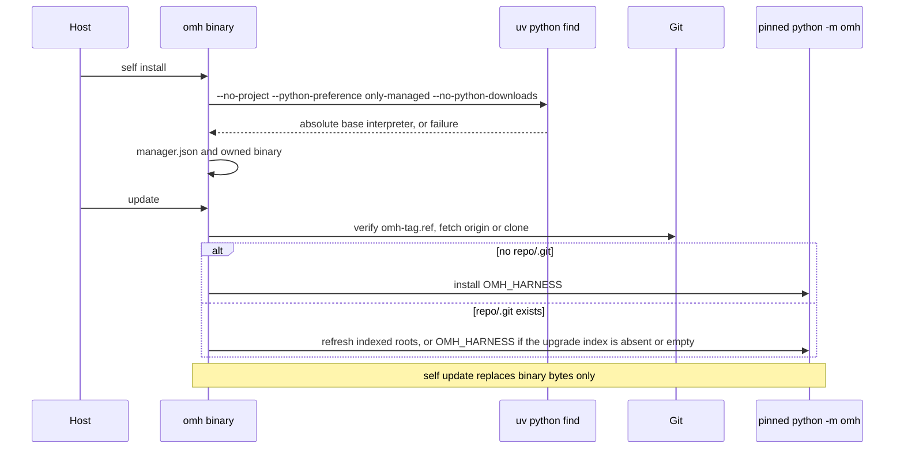

# Proposed ADR 0039: a static Rust manager binary

Status: proposal. This is not an accepted decision, and it is not a file under `docs/adr/`. Accepting it later would add `docs/adr/0039-*.md`. The last accepted ADR on disk is `docs/adr/0038-use-native-goals-for-long-running-tasks.md`, so 0039 is the next number. Nothing in this proposal edits installers, Python modules, tests, or ADRs.

The frozen boundary is already chosen. A static Rust `omh` owns manager install, self update, and self uninstall. The host already has uv. Skill and runtime Python come from that uv, pinned to one absolute interpreter. The binary does not download, patch, relocate, or vendor CPython. Skill content stays a verified source tag, separate from the binary release. `plugins/workflow/scripts/omh_runtime.py` and skill helpers stay Python and run on the pinned interpreter. Receipts, journals, the owner lock, conflict codes, and recovery stay behavior-compatible. This is a new distributor. It does not restore the retired Rust export core from `docs/adr/0031-sole-standalone-distribution.md`. `omh self update` replaces the binary. Content upgrade checks out a tag and re-projects installed targets. `omh self uninstall` removes the owned binary and its record, and leaves harness targets, runtimes, and the source checkout in place.

## Problem

The host manager is still the stateless shell pair `install.sh` and `install.ps1`. `docs/adr/0036-bootstrap-installer-script.md` says that pair runs once and exits, keeps no state, and has no self-update. POSIX entry is `curl …/install.sh | sh`. Windows saves `install.ps1` and runs it under PowerShell 5.1 or 7. Both require `git` and `curl` before they look at any URL (`install.sh` line 27, `install.ps1` line 134), and neither installs Python. The clone is `<home>/repo`, default home `~/.oh-my-harness`. A fresh run clones into a staging directory, checks the pinned SHA, then moves it into place. An existing `repo/.git` is an in-place upgrade. A path that exists and is not a git clone is a hard failure (`install.sh` lines 95–97, `install.ps1` lines 262–264).

That shell is also the upgrader. `omh update` is only allowed from the managed clone. `update_installer` in `omh/standalone.py` execs `/bin/sh <repo>/install.sh`, or `powershell`/`pwsh -File <repo>/install.ps1`, with `OMH_HOME` set and `OMH_VERSION` set when `--to` is present. Any other checkout fails with `OMH_SOURCE_NOT_MANAGED`. The Python CLI still has no git or network of its own (`docs/adr/0036-bootstrap-installer-script.md`). One verb therefore both checks out content and is the only way the installed command replaces itself, and on POSIX that command is not a binary. `install` and `refresh` write a `/bin/sh` shim to `~/.local/bin/omh` whose second line is `# oh-my-harness standalone launcher v1` (`SHIM_MARKER` in `omh/standalone.py`). The record is `<home>/shim.json`. `docs/adr/0033-standalone-launcher-shim.md` says the shim is a pointer: no checkout, no self-update, and if the checkout disappears the interpreter errors. Windows has no shim, so the manager command there is `python -B -m omh` (`README.md`).

`docs/adr/0031-sole-standalone-distribution.md` already retired the Rust export/import core and said a later distributor is a new ADR, not a restoration. The frozen boundary is that later distributor.

Two live documents disagree with the code. This proposal follows the code, and it does not edit the ADRs:

- `docs/adr/0036-bootstrap-installer-script.md` still describes a copies-only interpreter probe. `install.sh`, `install.ps1`, and `docs/adr/0037-venv-seeding-strategy.md` try `--copies`, then `--symlinks`. The installer records nothing. `prepare` records the winner as `seed`.
- `docs/adr/0033-standalone-launcher-shim.md` and `docs/adr/0035-standalone-cli-grammar-and-readable-output.md` still put `--bin-dir` and the runtime flags on `install` and `update`. `build_parser` in `omh/standalone.py` puts the runtime flags (`--python`, `--external-venv`, `--offline`, `--deployment-root`) on `prepare`, `install`, and `refresh`. `--bin-dir` is on `install` and `refresh` only (`shim_flag`). `prepare` does not take `--bin-dir`. `update` takes only `--to` plus the shared `--source` and `--home`. `docs/adr/0032-standalone-instruction-projection.md` still says `update` projects instructions. Projection is `install` and `refresh`.
- `docs/adr/0036-bootstrap-installer-script.md` says hosts can upgrade without curl, and it writes the upgrade fetch as `git fetch --tags --force` without a remote. Both scripts require `curl` unconditionally, and an in-place upgrade runs `git fetch --tags --force origin`.

## Decision

Ship a static Rust `omh` (Windows: `omh.exe`) as the installed manager command. It does not link libpython. It owns three operations, all under `self`: `omh self install` (manager install), `omh self update` (replace the binary), and `omh self uninstall` (remove the owned binary and its record).

Two release lines. Neither identity stands in for the other, and neither artifact carries the other.

- The binary release is the static executable plus its own checksum asset. It does not embed skills, `plugins/workflow/scripts/omh_runtime.py`, or a Python distribution.
- The content release stays a git tag plus the existing one-line `omh-<tag>.ref` commit SHA from `docs/adr/0036-bootstrap-installer-script.md`. `README.md` records the current asset as `omh-v1.4.0.ref`.

`omh self update` replaces binary bytes only. It does not check out a content tag, re-project harness files, change the Python pin, or touch `runtimes/`. Content upgrade is `omh update`: verify `omh-<tag>.ref`, check out that tag in `<home>/repo`, then re-project through the Python CLI. The binary must not exec `python -m omh update`. That verb calls `update_installer` and re-enters `install.sh` / `install.ps1`.

Every harness projection is still `python -B -m omh` on the pinned interpreter, with `PYTHONPATH` replaced by the recorded checkout, not extended. The child is the stdlib distributor. `AGENTS.md` and the `distributor-stdlib` rule in `scripts/architecture_rules.py` stay true for content: `omh/` imports only the standard library, and `python -m omh` remains the sole writer of plans, receipts, and journals.

This is the new distributor `docs/adr/0031-sole-standalone-distribution.md` allows. It does not restore static import, registry adapters, native Codex packages, `.omh` archives, `omh.lock.json`, or a second owner of plans, receipts, and recovery. `CONTEXT.md` keeps the Rust exporter sentence as retracted historical wording. It is also not the retired 1.0.0 git self-updater named in `docs/adr/0033-standalone-launcher-shim.md`.

The binary gains the git and network the shell has today, because content checkout moves out of `install.sh` / `install.ps1` and the Python module stays free of both. It does not gain a second projector. It does not gain a Python downloader.

If this proposal is accepted later, the ADR text would amend the sole-entrypoint sentence of ADR 0031, the shim and Windows clauses of ADR 0033, and the `--bin-dir` placement in ADR 0035. ADR 0036's `update` / `refresh` split and ADR 0037's seed probe stay. Historical ADR wording stays put until that acceptance. `install.sh` and `install.ps1` are not edited by this proposal.

## Ownership

Skill projection stays the sole content channel: `omh/__main__.py`, `omh/standalone.py`, and `omh/parameters.py`, under ADR 0031 and ADR 0032. The binary orchestrates checkout and then execs that CLI. It must not write skill-target bytes, call pip, or take `.omh-owner.lock`, `.prepare.lock`, or `.omh-home.lock`. Those locks are non-blocking (`lock()` in `plugins/workflow/scripts/omh_runtime.py`). A lock held across the exec becomes `HARNESS_RUNTIME_BUSY` inside Python. The binary therefore must not hold one while the child runs.

One physical harness root has one owner. The receipt is `<target>/.omh-owner.json` (`OWNER` in `omh/standalone.py`). A successful install or refresh writes `schemaVersion` 1, `owner` `"omh"`, `manager` as the absolute home, `target` as the absolute harness root, `sourceIdentity`, `slots`, and `files`. Canonical bytes are `encode` in `omh_runtime.py` (sorted, compact JSON). `receipt()` accepts the target only when `owner` is exactly `"omh"`, `manager` equals this home's path string, and `target` equals this root's path string. There is no realpath alias. Symlink or junction components fail in `safe_path()` with `HARNESS_RUNTIME_SPEC`. Formatting does not create another owner (`docs/adr/0030-independent-distribution-and-shared-runtime.md`).

`target_state()` classifies receipts for `status`. Mutating commands do not use it. The live split in `omh/standalone.py` is:

- No file means `missing` (install allowed; uninstall of an absent receipt is an empty plan).
- Non-JSON, or a missing `owner` or `manager` key, is `invalid-receipt`.
- `owner` other than `"omh"` is `foreign`.
- `owner` `"omh"` with another `manager` is `other-home`.
- A same-home receipt whose inventory cannot be read (`file_drift` raises `KeyError`, `TypeError`, or `ValueError`) is also `invalid-receipt`. `target_state()` does not fail `OMH_RECEIPT_INVALID`.

`OMH_RECEIPT_INVALID` is the mutating and recovery code. `receipt()` raises it for an unsupported `schemaVersion`, a non-list `slots`, a non-dict `files`, or an inventory that fails `relative()` and the slot-prefix check. `recover()` raises it with `Recovery identity mismatch` when the journal's `target` or `manager` string does not match, and writes nothing. Foreign, other-home, and a mismatched target path are `HARNESS_OWNER_CONFLICT` from `receipt()`, which `install` and `refresh` call before runtime preparation. Handoff is uninstall by the current owner plus finished recovery, not adoption (ADR 0031). A first install also refuses a native plugin table whose key's segment after the last `@` is exactly `oh-my-harness` (`plan()`). An inert plugin cache, a marketplace entry alone, or an unrelated malformed `config.toml` that does not contain those bytes is not an owner. No client config is edited.

The home must not be the target or a child of it (`OMH_PATH_INVALID` in `main`). A target under the home is not rejected by that one-directional check. `test_refresh_can_install_an_absent_target_within_manager_home` in `tests/test_standalone.py` uses `<home>/clients/codex/skills`. The runtime deployment root must be separate from the target in both directions. `prepare` writes `<home>/runtime-state.json` only and creates no target receipt.

`targets.json` is an index hint (`docs/adr/0034-status-surface-and-target-index.md`). The receipt is the truth. The code writes the index from `install`, `refresh`, and `uninstall` (`remember_target`), not from `update`.

The binary is not an owner. Its record is `<home>/manager.json`, the manager-install analogue of `<home>/shim.json`. It must not be written into `.omh-owner.json`, and it must not reuse `shim.json`. `write_shim` and `run_self` own `shim.json` and the v1 marker. A binary has no second line, so `shim_owned` is false, and today's `python -m omh self uninstall` cannot unlink it: a present non-marker file is `HARNESS_CONFLICT`, and a missing `shim.json` prints `no omh command to remove` and deletes nothing.

Proposed `manager.json` fields, schemaVersion 1: `kind` (`binary`), `binDir`, `path`, `source`, `python`, `pythonDigest`, `digest`, `binaryVersion`. `path`, `source`, and `python` are absolute. `digest` is the SHA-256 of the installed binary. `python` is the resolved base interpreter path from Runtime pin, and `pythonDigest` is the SHA-256 of that file. `status` does not read this file today. The content change in Content releases teaches it to expose the object as the existing `launcher` key without dropping `binDir`, `path`, `source`, or `python`, and adds `kind`, `digest`, and `binaryVersion`.

The lock file `<target>/.omh-owner.lock` is not an identity record. `lock()` creates it `0o600`, takes a non-blocking exclusive lock, and never unlinks or recreates it. The same primitive guards `<home>/.omh-home.lock` and `<home>/.prepare.lock`. A non-regular or hardlinked lock is unsafe.

Conflict codes stay the codes in `plan()`, `shim_preflight()`, and `run_self()`. The binary uses them for the command it owns and does not invent a takeover path. Unrelated files and empty directories stay. Matching an existing file's bytes does not adopt it.

| Code | Kept meaning |
| --- | --- |
| `HARNESS_OWNER_CONFLICT` | Another owner's receipt, another manager home, a mismatched target path, or a native `oh-my-harness` plugin entry on a receipt-less install. |
| `HARNESS_CONFLICT` | A projected path that exists and is not in the receipt; an owned file whose digest and bytes both differ, including on uninstall; a shadow file at plan time except uninstall (`SHADOWS`: `AGENTS.override.md` for codex, `Claude.md` and `AGENT.md` for grok); an unowned `omh` in the bin directory before the target transaction; `self uninstall` seeing bytes that are not the owned command. The file stays. |
| `HARNESS_RECOVERY_REQUIRED` | The journal exists. `plan()` and `transact()` both refuse. |
| `HARNESS_RECOVERY_CONFLICT` | Uncommitted recovery found bytes that are neither `before` nor `after`. The edit is kept. |
| `OMH_STATE_CHANGED` | Live bytes moved after the journal recorded `before`. |
| `OMH_FILE_INVALID` | Non-regular owned file, file over 128 MiB, more than 5000 files or changes, or a journal payload over 128 MiB of base64. |
| `OMH_PATH_INVALID` | Non-portable relative path, or home/target overlap. |
| `HARNESS_RUNTIME_BUSY` | Non-blocking lock held. |
| `HARNESS_RUNTIME_SPEC` | Non-absolute or control-bearing path (`absolute()`), or a linked deployment path (`safe_path()`). |
| `HARNESS_PYTHON_REQUIRED` | Explicit Python missing or not executable (`run_process` / `prepare`). Also the binary's missing or rejected pin, with no PATH fallback. |
| `OMH_SOURCE_NOT_MANAGED` | `update` from a checkout that is not `<home>/repo`. |
| `OMH_ENVIRONMENT_INVALID` | The process environment cannot support the run (stream reconfigure, missing `powershell`/`pwsh` in today's `update_installer`). Also a missing `manager.json` on a forwarded command. |
| `OMH_INVALID` | Malformed input or state with no more specific code (`error_line`). Dirty content trees and a malformed upgrade index use this code. The binary does not invent a new one. |
| `OMH_RECEIPT_INVALID` | `receipt()` rejected the receipt shape, or `recover()` rejected the journal identity. Not the `invalid-receipt` label from `target_state()`. |

Missing owned files are restored, not conflicts. `refresh` may install an absent target (`README.md`). A same-owner repeat whose plan has no file changes returns from `transact()` without writing a journal (`transact` returns when `changes` is empty). `remember_target()` and `write_shim()` still run afterward (`main` in `omh/standalone.py`). The repeat is not a no-write. An unowned `omh` at the public install path is `HARNESS_CONFLICT` before any content projection and before any copy or download.

The journal stays `<home>/transactions/<sha256 of the absolute target path>.json`, written by `transact()` and `recover()`. It holds `schemaVersion` 1, `manager`, `target`, `committed`, `changes` (`path`, base64 `before`, base64 `after`, null for create or delete), `createdDirectories` (shallow first), and `cleanupDirectories` (deep first). `schemaVersion` is written and not rechecked on read. A target or manager string mismatch is `OMH_RECEIPT_INVALID` (`Recovery identity mismatch`) and writes nothing. Apply order stays: refuse if a journal exists; return if there are no changes; atomically write `committed: false`; require live bytes to equal `before`; replace or unlink; remove empty cleanup directories; rewrite `committed: true`; unlink the journal. An ordinary failure calls `recover()` and reraises. A hard kill leaves the journal. Cross-file visibility is not atomic during the apply (ADR 0030).

`recover` with the same `--home` and the same target (default codex) stays: no journal means success and `recovered` false; uncommitted recovery reverses only when every path is still the `before` or `after` image, otherwise `HARNESS_RECOVERY_CONFLICT`; committed recovery only cleans empty directories and does not reject later edits. The receipt is one journaled change. Uninstall deletes it in that transaction. Rollback restores the previous receipt bytes. Neither target uninstall nor recovery deletes a managed venv, an external venv, a failed preparation, or `<home>/repo`.

`omh self uninstall` stays on that boundary. It removes the owned binary and `manager.json` only. It does not roll back a target journal and does not delete `.omh-owner.json`. A binary-record mismatch is not a target journal. Later commands refuse until `self update` is retried or the operator removes the unowned file. They do not rewrite target files to paper over it.

Three Python surfaces stay on the pinned interpreter. Repository validation does not move into the binary.

- Runtime provider. `plugins/workflow/scripts/omh_runtime.py` is protocol 1. Its operations are exactly `prepare`, `verify`, and `run`. Only `prepare` may create a venv or invoke pip. `prepare` and `verify` print `{"ok": ...}` or `{"error": {"code", "message"}}` on stdout and exit 0. `run` keeps the helper's stdout and uses stderr plus exit 1 only for its own startup failures (ADR 0030). `plugins/workflow/scripts/run.sh` and `run.ps1` stay beside it. They are shell, not the manager binary.
- Skill helpers stay in the source tag. `content-manifest.json` binds `workflow:sop` and `workflow:summary-in-html` to `workflow`, and `maintenance:doc-alignment` to `maintenance`. Both groups set `minimumPython` to `[3, 11]`, `imports` to `[]`, and `requirementsLock` to `null`. `projected()` copies those trees and rewrites a single `OMH_SHARED_SCRIPTS` assignment. `launch()` starts helpers with `prepared["python"]`. An invocation-local `OMH_PYTHON` must itself be a venv (`OMH_PYTHON must select a venv`). The manager pin is the bootstrap path passed into `prepare`, not this override.
- Content projector. Porting receipts, journals, or recovery into Rust would be a second projector, which is the shape ADR 0031 retired.

The venv marker is not a short record. `prepare()` in `plugins/workflow/scripts/omh_runtime.py` writes `<deploymentRoot>/<group>/<identity>/.omh-runtime.json` as the full descriptor `prepared`, `spec`, and `lock`, and after the winning strategy rewrites that same file with `seed` added. `prepared` holds `id`, `identity`, `root`, `python`, `external`, and `deploymentRoot`. The identity digest hashes the spec, the lock text, `interpreter.resolve()`, and the SHA-256 of that file's bytes. It is not reversible, and it is not the manager pin. The target binding `<target>/.omh-runtime/<group>.json` is a different file (`binding_files`): protocol, spec, prepared, and lock. Neither file is `manager.json`.

`scripts/`, plugin `tests/`, and `requirements.txt` stay developer and CI Python. The binary must not install or run them. `python scripts/check_architecture.py` and `python scripts/check_standalone_distribution.py` remain the content-tag gates. `scripts/check_content_export.py` is not a current command (ADR 0030's Rust bridge text is historical; ADR 0031 names the standalone checker).

## Commands

`self` is the omh command itself. Harness projection is `install`, `refresh`, and `uninstall`. `self` is handled inside the binary and is not forwarded, so `self uninstall` works when the checkout or the pinned interpreter is gone. Forwarded commands do not.

| Command | Who runs it | What it does |
| --- | --- | --- |
| `self install` | Binary only | Place or refresh the owned binary, pin the interpreter, write `manager.json`. No clone and no projection. |
| `self update [--to <binary version>]` | Binary only | Replace owned binary bytes after checksum verification. Do not check out a content tag, re-project, change the Python pin, or touch `runtimes/`. |
| `self uninstall` | Binary only | Remove the owned binary and `manager.json`. Leave harness targets, runtimes, and `<home>/repo`. |
| `install` | Binary execs Python | Project one harness. Do not create or rewrite the public `omh`. |
| `refresh` | Binary execs Python | Re-project from the recorded checkout, restore missing files, and install an absent target. Do not rewrite the public `omh`. |
| `uninstall <harness>` | Binary execs Python | Remove one harness. The binary, `manager.json`, runtimes, and `<home>/repo` stay. JSON stays `{changed}` with no `launcherRemoved` (`tests/test_cli_parameters.py`). |
| `update [--to <tag>]` | Binary, then Python `install` or `refresh` | Content upgrade. Not the binary. Not an alias of `self update`. The verb comes from clone mode, not from whether the index is empty. |
| `prepare`, `plan`, `status`, `recover` | Binary execs Python | Unchanged, including `plan --operation install\|refresh\|uninstall`, the default-codex hint, and stderr JSON errors. |

`omh self` with no leaf, and `omh self uninstall <harness>`, stay usage errors, exit 2 (`tests/test_cli_parameters.py`). `self update --to` and `update --to` are different parents. Content tags continue to use `OMH_VERSION`. Binary versions use `self update --to` and a proposed `OMH_BINARY_VERSION`. They must not read or write `OMH_VERSION`.

`--bin-dir` moves to `self install` only. The default stays `~/.local/bin` (`shim_target`). A relative path still fails the absolute-path check. Repeating `self install` on an owned binary is idempotent and may re-pin. A second bin directory while the recorded path still holds the owned binary fails until `self uninstall`. The Windows exception in ADR 0033 goes away for this command: `omh.exe` is a real launcher, so Windows `self uninstall` can remove it. `.omh-runtime/run.ps1` is unchanged. `prepare` still does not take `--bin-dir`.

`self uninstall` matches `run_self` outcomes and strings (`omh/parameters.py`):

- Recorded path exists and its digest matches `manager.json`: remove the binary and the record. Human text is `removed the omh command`. JSON is `{"removed": true}`.
- Record exists and the file is already gone: drop the record, print `no omh command to remove`, JSON `{"removed": false}`.
- Record exists and the digest does not match: `HARNESS_CONFLICT`. The file and the record stay. There is no record-less delete.
- No record: `no omh command to remove` and `{"removed": false}`, even if a stray `omh` exists.
- A second run reports that no command remains.
- Do not delete harness targets, `.omh-owner.json`, journals, `targets.json`, `<home>/repo`, `<home>/runtimes`, or `<home>/transactions`.

`self update` replaces bytes only when that is not a takeover:

- Destination matches the recorded digest: verify the new payload outside the bin directory, atomically replace, re-hash, then update `digest` and `binaryVersion`. The record changes only after the new bytes are in place. `python` and `pythonDigest` stay.
- Destination is absent and the record remains: place the verified payload into that empty path, then update the digest.
- Destination already matches the new verified payload while the record is stale: update the record only. That finishes an interrupted replace.
- Destination matches neither: `HARNESS_CONFLICT`. Do not overwrite. Later commands refuse. POSIX replace is atomic, so a crash does not leave a half-written `omh`. If Windows cannot replace a running `omh.exe`, fail closed and leave the old binary and the old digest.

Forwarded stdout, stderr, and exits 0, 1, and 2 pass through unchanged, including the codes in the table above plus `HARNESS_RUNTIME_OFFLINE_MISSING`, `HARNESS_RUNTIME_TIMEOUT`, `HARNESS_RUNTIME_INVALID`, `OMH_CONTENT_INVALID`, and `OMH_RECEIPT_INVALID`. Human summaries and `--json` stay as they are for content commands. The binary adds no second envelope. Its own failures use the same stderr object `error_line` writes: `{"error": {"code", "message"}}`, exit 1. Usage errors stay text on stderr, exit 2.

Before any projection or content checkout, the running binary reads `manager.json`. If the recorded file's bytes do not match `digest`, stop with `HARNESS_CONFLICT` and do not exec. If the pin file is missing or cannot be executed, stop with `HARNESS_PYTHON_REQUIRED` and do not search `PATH` for `python`, `python3`, or `py`. If the record itself is missing, stop with `OMH_ENVIRONMENT_INVALID` and do not search `PATH` for another checkout. An explicit `--source` on a content command may name a developer checkout. A successful `install` or `refresh` stores that path in `manager.json` `source`. `update` still requires `<home>/repo` to be that checkout and to contain `.git`. Otherwise the binary fails with `OMH_SOURCE_NOT_MANAGED` and the same guidance `main` prints today: use `omh refresh`, or bootstrap with `install.sh` on POSIX or `install.ps1` on Windows. It does not reach the Python `update` verb to do that.

The binary does not pass the public bin directory to the child. Today's `install` and `refresh` call `shim_preflight` and then `write_shim`, which would treat a Rust `omh` as unowned (`HARNESS_CONFLICT` before the transaction, and no receipt is written; `test_launcher_shim_lifecycle`) or, given another `--bin-dir`, retarget `shim.json` at a shell script. Until the content tag in Content releases ships, the binary forwards `install` and `refresh` with a private absolute `--bin-dir` of `<home>/.manager-bin`, then deletes a generated v1 shim in that directory and removes `shim.json` only when it points at that scratch path. It does this on child failure as well as success. It never deletes a `shim.json` that points elsewhere. Windows `write_shim` returns immediately (`os.name == 'nt'`), so the scratch dir stays empty there. The private directory is defense in depth, not a second launcher, and it is not placed on `PATH`.

Steady state, in the content generation that ships with the first binary host: `install` and `refresh` do not preflight or write the bin path when `manager.json` names that destination and the file digest matches. Developer checkouts with no `manager.json` keep ADR 0033. `python -m omh self uninstall` still reads only `shim.json`.

Interpreter precedence for a forwarded command follows the CLI: `--python` if the user passed one, else `OMH_PYTHON` if set, else the recorded pin (`main` reads `args.python`, then `OMH_PYTHON`, then `sys.executable`). The binary execs the winning absolute path for every forwarded command and passes it to the Python CLI as `--python` only for `prepare`, `install`, and `refresh`, so runtime preparation uses the same interpreter without changing other verbs' CLI grammar. On success, if that path differs from the record, update `python` and `pythonDigest`. Do not download it. A relative override still fails inside `absolute()` with `HARNESS_RUNTIME_SPEC`. `self update` does not take this path and does not change the pin.

## Bootstrap

The current scripts stay the bootstrap until this proposal is implemented. Their successor is a downloader of the static binary, not a second Python installer, and not a copy of the venv probe. This proposal does not edit `install.sh` or `install.ps1`.

A new host is then:

1. The downloader fetches the static binary, verifies its checksum outside the bin directory, and execs that file as `omh self install`.
2. `self install` pins the interpreter by the rules in Runtime pin, writes `manager.json`, and places the owned binary. It does not clone, does not project, and does not run the installer's `--copies` / `--symlinks` probe.
3. `omh update` acquires the verified content tag and projects. The verb is the clone mode below, not the shape of `targets.json`. No `<home>/repo/.git` is bootstrap and runs Python `install`. An existing `<home>/repo/.git` is upgrade and runs Python `refresh`.

`self install` refuses to replace an `omh` already at the destination unless it is this binary or the single migration case in Migration. An ADR 0033 shell shim is not owned by digest. Steps 1 and 2 do not run `uv python install`, do not download CPython, and do not keep a `uv` command name for later lookup.

### Checkout

Content checkout, when `omh update` runs, keeps the `install.sh` / `install.ps1` rules. The binary reports checkout failures itself. It does not shell out to `install.sh` for them.

Tools, before any URL is inspected:

- Require `git`.
- Require `curl` always, including when `OMH_REPO` or `OMH_REF_URL` is a local path. `install.sh` line 27 and `install.ps1` line 134 do this before release resolution. ADR 0036's sentence that hosts upgrade without curl disagrees with those lines. This proposal follows the scripts. "curl only for HTTPS" is not the rule.
- A local `OMH_REPO` still needs `OMH_VERSION` and `OMH_REF_URL` when the repo is not a GitHub URL (ADR 0036, and both scripts).

Tag and pin:

- Resolve the tag from `--to`, else `OMH_VERSION`, else one unauthenticated GitHub `releases/latest` call. A non-GitHub repo does not get that default.
- Compare `git ls-remote` of `refs/tags/<tag>^{}`, or the plain tag ref when the peeled advertisement is empty, with the `omh-<tag>.ref` SHA. The asset is whitespace-stripped and must be at least 40 characters.
- On upgrade, fetch with `git -C <clone> fetch --tags --force origin` (`install.sh` line 100, `install.ps1` line 268). The remote is `origin`, because checkout leaves a detached HEAD and the next upgrade has to see that remote's tags. A remote-less `git fetch --tags --force` is not the rule. ADR 0036 names `--tags --force` and the 1.1.1 reissue, and does not name `origin`. Follow the scripts.

Mode is fixed from the clone before the index is read (`install.sh` lines 94–102, `install.ps1` lines 265–273):

- A path that exists and is not a git clone is a hard failure (`<clone> exists and is not a git clone`).
- An existing `<home>/repo/.git` is `upgrade`.
- Otherwise the mode is `bootstrap`. A fresh clone goes to a staging directory (`<home>/.repo.clone.<pid>`), the pinned SHA is checked, then it is moved into `<home>/repo`. A failed clone removes the staging directory.

Cleanliness and checkout:

- Refuse a dirty tree before fetch when `<home>/repo/.git` already exists, and again after checkout, using `git status --porcelain --untracked-files=all --ignored`. Staged, unstaged, untracked, and ignored files all block, because ignored files can enter the distributor's walk (`require_clean_tree` in `install.sh`; ADR 0036 "Source cleanliness"). Never reset, clean, or stash. There is no dirty-tree code in the Python CLI today, so the binary reports this with `OMH_INVALID`, the existing stderr envelope, and exit 1. It does not invent a second envelope or a new code. The refusal happens before fetch, matching `tests/test_standalone.py` (`exercise_installer_dirty_checkout` asserts the trace has no `fetch` or `checkout`).
- After checkout, `HEAD` must equal the pinned SHA. Checkout is `git -c advice.detachedHead=false checkout --quiet refs/tags/<tag>`.
- Windows git children set `GIT_TERMINAL_PROMPT=0` and `GCM_INTERACTIVE=Never`, matching `install.ps1` lines 19–20. `install.sh` does not set them, and this proposal does not claim that it does. Windows clone and checkout also pass `-c core.autocrlf=false`, as `install.ps1` does, so a smudged tree does not fail closed. POSIX clone and checkout do not pass that config. Detached-head advice stays quiet on both.

### Target selection

The verb comes from the clone mode, not from the index. This is the embedded selector at `install.sh` lines 133 and 154 and `install.ps1` lines 317 and 338:

```text
targets = read targets.json only when mode == upgrade and the index exists, else {}
verb = install if mode == bootstrap else refresh
```

- Bootstrap does not read `targets.json`. A leftover index, a populated index, an empty index, or a malformed index does not choose roots and does not stop the run. The targets are `OMH_HARNESS` (default `codex`, from `${OMH_HARNESS:-codex}` and the PowerShell equivalent). The verb is `install`. A re-clone that left `targets.json` behind still installs `OMH_HARNESS`. It does not refresh the leftover roots.
- Upgrade always uses `refresh`. An absent index is not read, so the selection is empty and `OMH_HARNESS` fills it, and the verb stays `refresh`. An existing empty object is the same: `OMH_HARNESS`, verb `refresh`. A populated index is refreshed entry by entry. `OMH_HARNESS` must not add targets. Two roots for the same harness are two refreshes. That is `exercise_installer_indexed_targets` in `tests/test_standalone.py`: `OMH_HARNESS=grok` on upgrade must not create a grok root.
- A malformed or unreadable index stops an upgrade before any target write, and the index bytes stay (`exercise_installer_corrupt_index`). Bootstrap does not perform that check, because it does not read the index. The binary reports the upgrade failure with `OMH_INVALID` and does not invent a new code. ADR 0036's "absent or empty index uses `OMH_HARNESS`" applies to the upgrade path, which is the only path that consults the index. It does not turn an absent index into `install`.

Unknown harness names fail against `HARNESS_ROOTS` before writes. After writes, run `status` per selected target. A failed check is nonzero and does not roll back completed writes. The script's text is `Target writes are not rolled back; inspect the reported target status.`

Deleting `<home>/repo` no longer deletes the manager. Forwarded commands then fail closed because the recorded source is gone. The binary does not search `PATH` for another checkout or another interpreter.

## Runtime pin

The host already has uv. `omh self install` pins one already-installed absolute interpreter once. It does not call an unqualified `uv python find`. That default prefers an active `VIRTUAL_ENV` or a project `.venv`, then interpreters on `PATH`, and with uv's default `python-downloads=automatic` it can download a managed CPython. `README.md` selects the bootstrap interpreter only from an absolute `--python`, an absolute `OMH_PYTHON`, or the process already running the command, and it states there is no project-venv or PATH search. `docs/adr/0030-independent-distribution-and-shared-runtime.md` requires that same `python` parameter to be an explicit absolute path with no PATH lookup. `docs/adr/0036-bootstrap-installer-script.md` says the installer never installs Python. "Do not run `uv python install`" does not by itself stop `uv python find` from downloading. A hit on `<venv>/bin/python` or `Scripts/python.exe` is also forbidden: the manager record must be the base interpreter file that `prepare` hashes, not the venv interpreter.

Discovery order for `self install`:

1. An explicit `--python`, if the operator passed one. It must already be absolute. `absolute()` (`plugins/workflow/scripts/omh_runtime.py`) rejects a relative path, a `..` part, or a control character with `HARNESS_RUNTIME_SPEC`. There is no `Get-Command` or `command -v` fallback. `install.ps1`'s `Resolve-CommandPath` on a bare `OMH_PYTHON` is the shell bootstrap, not this pin.
2. Else an absolute `OMH_PYTHON`, with the same checks. A relative value is `HARNESS_RUNTIME_SPEC`, not a PATH lookup.
3. Else one uv query, because the frozen boundary says the unattended pin comes from the host's uv and the binary has no Python of its own. The binary may resolve the tool name `uv` (Windows: `uv.exe`) to run that query. It must not resolve `python`, `python3`, or `py` from `PATH`. If `uv` itself is missing, stop with `HARNESS_PYTHON_REQUIRED`.

The query is not `--system` and not `only-system`. Those select a system interpreter and ignore uv-managed ones, which breaks the boundary that the pin comes from uv. The query is:

```text
uv python find --no-project --python-preference only-managed --no-python-downloads
```

The child environment also sets `UV_NO_PROJECT=1`, `UV_PYTHON_DOWNLOADS=never`, and `UV_PYTHON_PREFERENCE=only-managed`, and it unsets `VIRTUAL_ENV` and `UV_PROJECT_ENVIRONMENT`. The working directory is not a project checkout. No version request is passed: a requested version that is not installed is what a download-enabled find would fetch, and this pin must not ask for one. `--no-python-downloads` together with `UV_PYTHON_DOWNLOADS=never` is what stops `python-downloads=automatic`. `--no-project` plus the cleared virtualenv variables is what stops a project `.venv` or an active `VIRTUAL_ENV` from winning. `only-managed` is what stops the PATH fallback to a system `python3`.

Accept the printed path only when all of these hold:

- It is one absolute path. Resolve it with `Path.resolve()`. A non-absolute or control-bearing result is `HARNESS_RUNTIME_SPEC`.
- The resolved path is an existing file that can be executed. Otherwise `HARNESS_PYTHON_REQUIRED`, using the messages `probe()` already prints: `Explicit Python is missing` or `Cannot execute explicit Python`.
- Executing it shows Python 3.11 or newer and `sys.prefix == sys.base_prefix`. A venv (`prefix != base_prefix`), including `<venv>/bin/python` or `Scripts/python.exe`, is `HARNESS_PYTHON_REQUIRED`. Do not record it. Do not fall through to another interpreter.

Store that resolved path and the SHA-256 of that file's bytes. That is the pair `prepare` already hashes: `interpreter.resolve()` and `hashlib.sha256(interpreter.read_bytes())` in `omh_runtime.py`. Do not record the string `uv`, `python3`, a PATH entry, `<venv>/bin/python`, or `Scripts/python.exe`. Do not record a copy made by `omh`.

If `uv` is missing, `uv python find` fails, the result is not an absolute base interpreter, the version is older than 3.11, or the file cannot be executed, stop with `HARNESS_PYTHON_REQUIRED`. Do not run `uv python install`. Do not substitute another interpreter. `README.md` already refuses a project-venv or PATH search for `--python`.

Do not copy the shell probe in front of the binary. `docs/adr/0037-venv-seeding-strategy.md` stays inside `prepare`, because a uv-managed build can pass a version check and still die in `venv --copies` with `Failed to import encodings`. `prepare` is the only seeder. The binary has no strategy flag.

1. Probe the bootstrap interpreter for Python 3.11 or newer before creating anything.
2. Write `.omh-runtime.json` on the final path before building, as the full `prepared` / `spec` / `lock` descriptor. Venvs are never staged and renamed.
3. Try `python -I -B -m venv --copies` first. A group with no requirements, which is both current groups, adds `--without-pip`.
4. Probe the venv interpreter in place (`bin/python` or `Scripts/python.exe`). It must be a venv (`prefix != basePrefix`, `prefix` resolving to that root) at a matching version.
5. On failure, delete `python*` in that `bin` or `Scripts` directory, because `venv` will not replace an executable that is already there, then retry `--symlinks` with the same probe.
6. Store the winner as `seed` on that full descriptor. If both fail, the error is the process tail.
7. Only a non-empty requirements lock runs isolated, hashed, binary-only pip. Current groups never reach that step.

The recorded runtime path is not the bootstrap path. The managed layout stays `<deploymentRoot>/<group>/<identity>`, default deployment root `<home>/runtimes`. Later content commands exec the pinned path and do not call uv again. If uv deletes the pinned interpreter, the next command fails closed with `HARNESS_PYTHON_REQUIRED` (`Explicit Python is missing` or `Cannot execute explicit Python`). A process that starts and then dies stays `HARNESS_RUNTIME_INVALID` with the process tail. Nothing retargets the symlink, recopies another Python, or downloads a replacement. The repair is `omh self install --python <absolute base interpreter>`. The old venv directory stays. ADR 0037's trade-off stays visible: a symlinked venv lives only as long as that base file lives, and standard interpreters keep private copies because `--symlinks` runs only when `--copies` fails its probe.

The manager record cannot be the venv path. After a prune, `<venv>/bin/python` may still exist as a symlink whose target is gone. The path uv deleted is the bootstrap file hashed into the runtime identity. Helper sessions keep using `<group>.python` under `.omh-runtime`, not the binary and not the pin, except when `prepare` is rebuilding.

## Content releases

Binary release and content tag are separate artifacts. `omh self update` verifies the binary checksum and replaces the recorded file. It does not fetch `omh-<tag>.ref`, re-project targets, or touch `runtimes/`. `omh update` verifies the content ref, checks out that tag, and re-projects. It does not replace the binary.

The content tag that first runs under the binary needs one authorized CLI change before a binary host can project through the public bin path. When `manager.json` names that destination and the on-disk digest matches, `install` and `refresh` skip `shim_preflight` and `write_shim`. `status --json` reports that record as `launcher`, including `kind`, `digest`, and `binaryVersion`, and keeps `binDir`, `path`, `source`, and `python`. Text status may show `binaryVersion`. The same generation must not let `python -m omh update` become a second git implementation. It may keep delegating to `install.sh` / `install.ps1` only when `manager.json` is absent. When `manager.json` is present, that Python verb must not exec the shell, because the shell is no longer the manager; the installed `omh update` is. Developer checkouts with no `manager.json` keep today's `update_installer` behavior (`tests/test_standalone.py` `test_update_delegates_only_from_the_managed_clone`).

`python -B -m omh` stays the content implementation and the developer entry. Tests and `scripts/check_standalone_distribution.py` can keep calling it. The installed `omh` on `PATH` becomes the binary.

Receipt schema 1, the journal, and `.omh-owner.lock` stay as implemented. A content upgrade does not import a payload. Rollback of content remains checking out an older tag and running `refresh`. Rollback of the manager remains `omh self update --to <older binary version>`. The two rollbacks do not move together.

## Migration

An owned v1 shell shim is the only migration overwrite. `self install` may replace the destination only when `<home>/shim.json` records that path and the file's second line is `# oh-my-harness standalone launcher v1`. It then removes the shim and `shim.json`, places the binary, and writes `manager.json`. It does not delete harness targets, runtimes, or `<home>/repo`. A marker without a matching `shim.json`, or a `shim.json` whose file is not the marker, is `HARNESS_CONFLICT`. The file stays. The operator's pre-migration removal remains `python -m omh self uninstall`, which deletes the shim and `shim.json` only (`remove_shim`).

After that replacement, an old CLI left on the checkout cannot delete the new binary. `run_self` treats a file whose second line is not the marker as `HARNESS_CONFLICT` and leaves it. Hosts that never had a shim, including Windows, `self install` into an empty path. An existing unowned `omh` or `omh.exe` is `HARNESS_CONFLICT` and is not replaced.

An installed codex or grok target is not migrated by the binary. Its receipt stays the owner. A later `omh update` or `omh refresh` re-projects through Python. A foreign receipt, another manager home, or a native `workflow@oh-my-harness` plugin entry remains `HARNESS_OWNER_CONFLICT` until that owner uninstalls and recovery finishes. A uv-managed interpreter that later disappears is not repaired by retargeting or by `uv python install`. The next command fails `HARNESS_PYTHON_REQUIRED`. The operator runs `omh self install --python <absolute base interpreter>`. The old venv directory stays.

Until the content generation in Content releases is the checked-out tag, `status` will not show `manager.json`, and a direct `python -m omh install` against the public bin path will still raise `HARNESS_CONFLICT`. The binary's private `--bin-dir` is what lets `omh update` re-project an older tag without letting `write_shim` replace `~/.local/bin/omh`. Once the matching content tag is current, that scratch directory should stay empty. It remains so a later `omh update --to` of an older tag cannot steal the record.

`AGENTS.md`'s authority sentence stays true for content. When the ADR is accepted, the map gains the manager binary as a separate distributor. `README.md`'s "POSIX shim is a static pointer with no self-update" becomes false only for hosts on this binary. Pre-migration hosts keep `install.sh` and `install.ps1`.



## Verification

No product check changes in this proposal. When it is implemented, the existing content suites stay the projection oracle, and the binary adds only the manager cases below. The tests describe today's shell shim. They move with the implementation. They are not rewritten ahead of it.

Receipts, journals, locks, and recovery, all in `tests/test_standalone.py` unless noted: `test_other_manager_owner_cannot_be_taken_over`, `test_receipt_and_path_validation_report_specific_codes`, `test_inert_native_cache_is_not_an_owner_but_native_installation_is`, `test_unrelated_invalid_client_config_does_not_block_skill_projection`, `test_user_modified_managed_file_is_protected`, `test_missing_files_are_restored_and_unrelated_content_is_preserved`, `test_failed_first_install_recovers_and_can_retry`, `test_hard_interruption_rollback_and_post_crash_edit_protection`, `test_committed_recovery_does_not_reject_later_user_edits`, `test_committed_cleanup_preserves_linked_or_file_replacement_paths`, `test_linked_target_and_source_fail_before_writes`, `test_shared_target_lock_refuses_competing_process`, `test_home_lock_refuses_competing_index_update`, `test_refresh_can_install_an_absent_target_within_manager_home`, `test_repeat_refresh_uninstall_and_external_environment_preservation`, `test_global_instructions_are_projected_protected_and_uninstalled`, `test_runtime_only_prepare_has_no_target_or_installed_receipt`. `scripts/check_standalone_distribution.py` locks receipt bytes, native `workflow@oh-my-harness` `HARNESS_OWNER_CONFLICT`, unowned `AGENTS.md` `HARNESS_CONFLICT`, harness uninstall leaving the POSIX shim, and `self uninstall` returning `{"removed": true}`.

Uninstall and `self`, in `tests/test_cli_parameters.py`: `test_claude_alias_uninstalls_only_claude_code_and_keeps_the_launcher`, `test_uninstall_without_a_target_exits_2_and_leaves_files`, `test_harness_uninstall_leaves_the_omh_command`, `test_self_uninstall_removes_only_the_omh_command`. `tests/test_standalone.py` `test_launcher_shim_lifecycle` locks the shim conflict before any receipt write.

Update delegation and checkout, in `tests/test_standalone.py`: `test_update_delegates_only_from_the_managed_clone`, `test_update_on_windows_delegates_to_install_ps1`, `test_bootstrap_and_upgrade_flow_through_install_sh`, `test_bootstrap_and_upgrade_flow_through_install_ps1`, `test_installer_refreshes_every_indexed_target_sh`, `test_installer_refreshes_every_indexed_target_ps1`, `test_installer_preserves_dirty_same_tag_checkout_sh`, `test_installer_preserves_dirty_same_tag_checkout_ps1`, `test_installer_preserves_post_checkout_changes_sh`, `test_installer_preserves_post_checkout_changes_ps1`, `test_installer_rejects_corrupt_target_index_sh`, `test_installer_rejects_corrupt_target_index_ps1`.

Venv seeding, in `tests/test_standalone.py`: `test_relocated_build_falls_back_to_symlinked_seeding`, `test_stdlib_group_does_not_install_pip`, `test_owned_partial_preparation_resumes_without_deleting_files`, `test_partial_preparation_never_writes_through_user_links`, `test_valid_runtime_does_not_depend_on_marker_format_or_identity`, and `test_unknown_incompatible_directory_is_not_rebuilt`. `docs/adr/0037-venv-seeding-strategy.md` matches `prepare()`: `--copies`, then delete `python*` and retry `--symlinks`, then record `seed` on the full descriptor.

Before the static binary replaces `python -m omh` on `PATH`, the first increment keeps those Python suites as the projection oracle and reproduces only the manager surface:

- Exec the pinned interpreter for `install`, `refresh`, `uninstall`, `prepare`, `plan`, `status`, and `recover`. Pass stdout, stderr, and exits 0, 1, and 2 through.
- Do not take `.omh-owner.lock`, `.prepare.lock`, or `.omh-home.lock`.
- Do not exec `python -m omh update`. `update_installer()` re-enters `install.sh` or `install.ps1`, and `write_shim()` would treat the Rust file as unowned (`test_launcher_shim_lifecycle` fails before any receipt write).
- Until `install` and `refresh` skip the shim when `manager.json` matches, forward with the private absolute `--bin-dir` and remove only a v1 shim and `shim.json` that point at that scratch path, including when the child exits 1.
- Content `update` keeps the managed-clone gate and the `omh refresh` guidance from `main()`. It refuses a dirty tree, including ignored files, before fetch. On an existing clone it refuses a corrupt index before writes and `refresh`es every indexed root. On a fresh clone it ignores the index and `install`s `OMH_HARNESS`.
- `self` with no leaf and `self uninstall <harness>` stay exit 2.
- Harness uninstall stays `{changed}` with no `launcherRemoved` and leaves the binary and `manager.json`.
- `self uninstall` keeps the `run_self` outcomes: `removed the omh command` / `{"removed": true}`, `no omh command to remove` / `{"removed": false}`, and `HARNESS_CONFLICT` when the recorded bytes do not match, without deleting receipts, journals, `runtimes/`, or `repo`.
- The binary does not choose `--copies` or `--symlinks`, does not call `uv python install`, and does not search `PATH` for a missing pin.

The binary's own checks, each tied to a failure the suites cannot see today:

- `self install` on an unowned `omh` exits 1 with `HARNESS_CONFLICT` and leaves the bytes. No `manager.json` is written.
- `self install` on a marker shim recorded by `shim.json` replaces that file, removes `shim.json`, and leaves `manager.json` `digest` equal to the file on disk. A second `self install` with the same pin changes nothing.
- `self install` with no absolute `--python` and no absolute `OMH_PYTHON` runs only the constrained `uv python find` above. A project `.venv`, an active `VIRTUAL_ENV`, a PATH `python3`, or a downloaded interpreter is not recorded. A venv result is `HARNESS_PYTHON_REQUIRED` and writes no `manager.json`.
- `self update` with a bad checksum does not replace the file or the digest. A good checksum updates both and leaves `python`, `pythonDigest`, `<home>/repo`, and `runtimes/` unchanged.
- Bytes that match neither the recorded digest nor the verified payload are `HARNESS_CONFLICT` for `self update` and for a later content command. `self uninstall` in that state also leaves both. A missing recorded file is replaced only by `self update`, and is dropped only by `self uninstall` with `removed: false`.
- `self uninstall` does not delete `.omh-owner.json`, `<home>/transactions`, `<home>/repo`, or a venv. A second run prints `no omh command to remove`.
- `omh uninstall` of one harness leaves the binary and `manager.json`.
- `omh update` from a non-managed `--source` is `OMH_SOURCE_NOT_MANAGED` and does not exec `install.sh`, `install.ps1`, or `python -m omh update`. A dirty `<home>/repo`, including an ignored file, exits 1 with `OMH_INVALID` and does not fetch. A clean upgrade of an existing `<home>/repo/.git` execs `refresh` on the pinned interpreter even when `targets.json` is absent or empty. A clean bootstrap, with no `<home>/repo/.git`, execs `install` of `OMH_HARNESS` and does not read `targets.json`. The child's exit code passes through.
- A forwarded `install` does not leave a shim at `~/.local/bin/omh` and does not leave `shim.json` pointing at `<home>/.manager-bin`, including when the child exits 1.
- A missing pin, or a pin whose file uv has removed, is `HARNESS_PYTHON_REQUIRED` with no PATH fallback and no `uv python install`. `prepare` on that pin still selects `--copies` and then `--symlinks` inside Python. The binary has no strategy flag.
- The binary does not contain, write, or read an `omh.omh` archive or `omh.lock.json`.

`python scripts/check_architecture.py` and `python scripts/check_standalone_distribution.py` remain the content-tag gates. They are not replaced by a Rust export check.

## Non-goals

- Building, downloading, patching, relocating, or vendoring CPython. Copying uv's interpreter into the home. Running `uv python install`. An unqualified `uv python find`. Passing `--system` or `only-system` in order to find a non-uv interpreter.
- Choosing `--copies` versus `--symlinks` in Rust, moving or deleting venvs on `self update` or `self uninstall`, or retargeting a dangling venv symlink.
- A Rust implementation of projection, journals, the owner lock, recovery, or runtime protocol 1. Restoring the retired export/import core, registry adapters, native packages, `.omh` archives, or `omh.lock.json`.
- Editing `install.sh`, `install.ps1`, product code, tests, or ADRs as part of this proposal. Removing the shell pair is later work. Their successor is a binary downloader, not a second Python installer.
- Making `omh update` and `omh self update` the same verb, or teaching the Python module git.
- Automatic upgrade, a central fleet store, or client-config edits.
- Rewriting skill helpers or `omh_runtime.py` into the binary. Changing receipt schema 1, journal shape, conflict-code meanings, or the `prepare` marker shape.
- Treating the binary record as a target owner, or deleting harness targets, runtimes, or the source checkout from `self uninstall`.
- Selecting targets from `targets.json` on a bootstrap, or using `install` for an upgrade whose index is absent or empty.

## Review panel

Three panels reviewed the draft. All three returned. None is missing. Each blocker is resolved in the sections above. None is left open.

### review-boundary

The draft pinned `self install` with an unqualified `uv python find`. That lookup prefers a project `.venv` or `VIRTUAL_ENV`, then `PATH`, and with uv's default `python-downloads=automatic` it can download CPython. `README.md`, `docs/adr/0030-independent-distribution-and-shared-runtime.md`, and `docs/adr/0036-bootstrap-installer-script.md` do not allow that, and a venv path is the record this proposal forbids.

Resolved in Runtime pin. The unattended query is `uv python find --no-project --python-preference only-managed --no-python-downloads`, with downloads and project discovery forced off in the child environment, and with `VIRTUAL_ENV` unset. `--system` is rejected because it would leave uv's interpreter. The result must be an absolute base interpreter (`sys.prefix == sys.base_prefix`) at Python 3.11 or newer. Failure is `HARNESS_PYTHON_REQUIRED` or `HARNESS_RUNTIME_SPEC`. There is no `uv python install` and no PATH search for `python3`.

The same panel's other checks hold and are unchanged: the binary does not reimplement uv's Python builds, content tags stay a separate artifact from the binary release, and `omh self update` replaces binary bytes only.

### review-migration

The draft said content upgrade keeps the installer rules, then specified a different target rule: an absent or empty index uses `OMH_HARNESS` and then `install`, and any other index is `refresh`. `install.sh` lines 133 and 154, and `install.ps1` lines 317 and 338, choose the verb from the clone. The index is read only when `mode == 'upgrade'` and the file exists. Bootstrap ignores the index and runs `install`. Upgrade always runs `refresh`, including when the index is absent or empty. `docs/adr/0036-bootstrap-installer-script.md` requires that upgrade refresh, with `OMH_HARNESS` only as the empty-index default.

Resolved in Bootstrap, Checkout, and Target selection, and repeated in Verification so the upgrade case is not "refresh, or install when the index is absent." Bootstrap step 3 now uses the same split.

The same panel rejected "curl only for HTTPS" and a remote-less `git fetch --tags --force`. Both scripts require `curl` before they look at the URL (`install.sh` line 27, `install.ps1` line 134). An in-place upgrade fetches `origin` (`install.sh` line 100, `install.ps1` line 268). Checkout follows those lines. Windows-only `GIT_TERMINAL_PROMPT`, `GCM_INTERACTIVE`, and `core.autocrlf=false` are attributed to `install.ps1`, not to `install.sh`.

The migration cases that were not in dispute stay in Migration: an owned v1 shim is the only overwrite, a developer checkout with no `manager.json` keeps ADR 0033, Windows with no shim installs into an empty path, an installed codex or grok target stays under its receipt, and a uv interpreter that disappears fails closed. The design does not restore ADR 0031's retired Rust exporter.

### review-verification

Four preserved-behavior claims in the draft were wrong and are not part of this proposal:

- `target_state()` returns `invalid-receipt` when a same-home inventory cannot be read. It does not fail `OMH_RECEIPT_INVALID`. That code is `receipt()` on the mutating path and `Recovery identity mismatch` in `recover()`. Stated in Ownership.
- A same-owner repeat with no file changes returns from `transact()` without a journal, and `remember_target()` and `write_shim()` still run. Stated in Ownership. The old "writes nothing" sentence is withdrawn.
- `<deploymentRoot>/<group>/<identity>/.omh-runtime.json` stores the full `prepared` / `spec` / `lock` descriptor plus `seed`, not only the venv Python, the group, and `seed`. Stated in Ownership and Runtime pin.
- `--bin-dir` is on `install` and `refresh` only. `prepare` does not take it (`build_parser()`). Stated in Problem, Decision, and Commands.

The first Rust increment must keep the Python suites named in Verification as the projection oracle and must reproduce only the manager surface that panel listed: pass-through exec of the pinned interpreter, no owner locks in the binary, no `python -m omh update`, the private `--bin-dir` until the content tag skips the shim, clone-mode target selection, dirty-tree and corrupt-index refusal, `self` usage exit 2, harness uninstall leaving the binary, `run_self` uninstall outcomes, and no `--copies`, `--symlinks`, `uv python install`, or PATH search for a missing pin.

## Open questions

None. The three review panels are present, and each blocker is resolved against the files named in Review panel. No product file was left in conflict with this text on purpose. Historical ADR wording that disagrees with `install.sh`, `install.ps1`, and `omh/standalone.py` stays in `docs/adr/` until a later acceptance, and this proposal follows the code.
